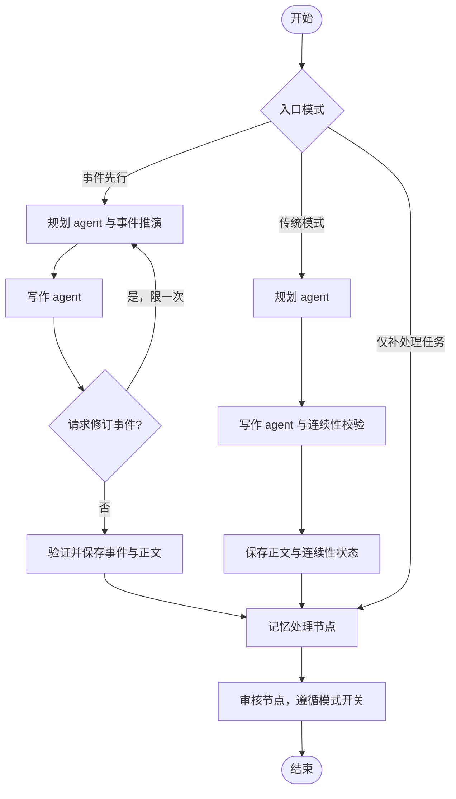

# Tome Agent：LangGraph 多智能体架构

当前编排框架为 LangGraph，模型传输仍使用既有 DeepSeek 适配器，小说事实与记忆校验仍由领域模块负责。框架负责节点执行和条件路由，领域模块负责证据、状态版本和提交完整性。

## 网页与命令行实际入口

`inf_backend.service` 和 `user_runtime` 均调用 `memory_runtime.writing.WritingSession`。会话初始化时构建并编译 `memory_runtime.graph_runtime.build_writing_graph()`，`write_next()` 通过 `graph.invoke()` 调度。

- 节点名：`event_planner`、`event_writer`、`event_commit`、`legacy_planner`、`legacy_writer`、`legacy_commit`、`memory`、`reviewer`。
- 事件先行模式沿用原有策略：结构化事件先推演、正文后保存；该模式原先就关闭正文故事审核，此次没有偷偷开启额外模型调用。`reviewer` 节点遵循原开关，关闭时不调用审核模型。
- 写作 agent 提出事件修订时，经条件边返回 `event_planner`，保留已有的一次修订上限、五次规划输出预算和降级策略。阶段正文保存、受控格式修复仍在领域节点内执行。
- `finish_pending()` 也经图入口直接进入 `memory → reviewer`，补处理已有章节，不再规划或重写正文。
- 记忆或审核服务失败后，既有策略是保留草稿并记录未完成任务。不能把 `DRAFT_UNCHECKED` 称为内容审核通过。
- 图工作区是单次调用的临时数据；同一会话不可并发写入。正式作品由既有检查点保存，避免图数据库和作品文件形成两个相互竞争的事实源。

## 基础严格事务流程

以下流程对应 `inf_writer.runtime.Coordinator`，同样使用真实编译后的 LangGraph 图。它与上面的“先保存草稿”策略不同：审核拒绝时正式状态保持不变。

## 主流程

1. `ContextBuilder` 从正式快照提取全书目标、约束、最近章节、未写计划和当前有效事实。
2. `planner` 只规划下一章，可局部调整尚未写作的后续计划。
3. `writer` 根据计划和记忆产生正文候选，不直接改动正式状态。
4. `memory` 从正文提出事实的 `store`、`update` 或 `retire` 变更，并附正文证据。
5. `reviewer` 独立判断正文与事实变更是否存在硬矛盾或遗漏。
6. `reviewer` 条件边选择 `commit` 或 `reject`；通过后将章节、计划和记忆作为一次事务提交，拒绝则返回拒绝结果。

## 核心模块

| 模块 | 职责 |
| --- | --- |
| `agents.py` | 四种角色的提示词、JSON 输出契约和有限格式修复 |
| `runtime.py` | 上下文组装、四角色调度、提交与审计 |
| `memory_runtime/graph_runtime.py` | 长篇实际入口的 StateGraph 节点、模式路由、修订回边和补处理入口 |
| `domain.py` | 快照结构、严格 JSON、章节事务和证据校验 |
| `memory.py` | 当前事实和版本历史查询 |
| `storage.py` | 原子写入、作品锁与 compare-and-swap 版本检查 |
| `models.py` | 模型请求、响应、预算和网关 |
| `chat_provider.py` | DeepSeek 兼容 Chat Completions HTTP 传输 |
| `drafting.py` | 草稿优先实验流程，保留未完全审核的正文但不提升其记忆 |

## 正式快照

`Snapshot` 保存作品目标、约束、章节、章节计划、有效事实、事实历史、幂等回执和版本号。事实以“主体 + 稳定英文属性”作为身份；更新和退役必须声明预期版本，并引用本章正文中的原句。旧值进入历史，方便追查变化来源。

正式流程采用复制后校验：任一事实、证据、章节顺序、模型输出或审核结果不合格，原快照保持不变。提交时再次核对快照版本并使用原子文件替换，防止两个写入者覆盖彼此。

## 长文本策略

默认上下文包含最近两章、当前有效事实和后续计划，较早正文不重复发送，但其结构化事实继续保留。达到事实数或上下文长度上限时系统明确报错，不静默删除事实。后续需要增加检索、摘要分层和篇幅控制，并通过对照实验验证效果。

## DeepSeek 边界

真实请求只允许 DeepSeek 官方 HTTPS 地址。API Key 从 `code/backend/.env` 或环境变量读取，不写入存档、日志或仓库。传输层不自动重试；每次操作受调用次数、时间和费用上限约束。当前自动测试只使用固定模型和本机模拟 HTTP 服务。

## 迁移与能力边界

固定依赖为 `langgraph==1.2.17`。LangGraph 负责执行图，应用的原子检查点、幂等回执、版本检查和审计继续负责数据保存。运行时指纹包含源码以及 LangGraph 版本，旧版存档不能直接续写，也不自动改写其指纹。

本次未启用 LangGraph 原生 checkpointer、节点级重放或 `interrupt()` 人工暂停；不能把框架支持的所有能力都当成本项目已经实现的功能。新版中断恢复仍由已经保存的事件阶段和待处理任务重建。完整说明见 `../software/LANGGRAPH_MIGRATION.md`。

