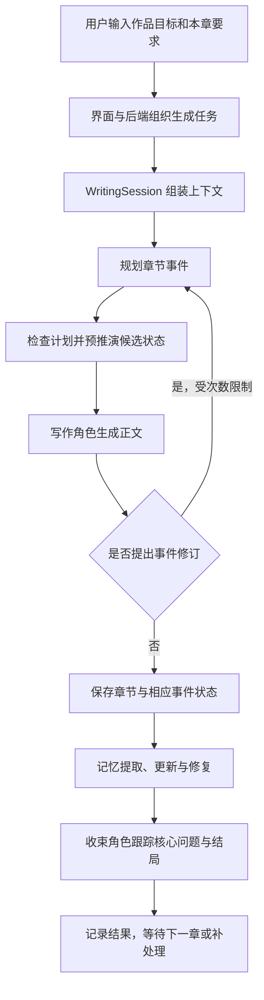

# Tome Agent 答辩准备：代码、算法与工作流

> 根据当前仓库代码整理。适合用作讲稿底稿、PPT 素材和现场问答手册。代码实现、测试证据与尚待验证的效果分别说明；示例人物与情节用于解释机制。

## 一、项目要解决什么问题

Tome Agent 是一个面向长篇小说创作的辅助系统。用户提出创作目标、设定和章节要求，系统组织多个不同职责的模型角色，逐章规划并生成内容，同时维护故事中的人物、事件、物品、时间和历史信息。

长篇写作的难点不只是“生成一章”，而是**后面几十章仍然能够沿用之前建立的世界状态**。如果每次只让大模型根据一条提示词续写，容易发生人物位置突然变化、已经丢失的物品再次出现、角色知道自己不应该知道的秘密等问题。直接把全书正文反复塞进提示词，又会受到上下文长度和调用成本限制。

我们的主要思路是：把一次写作拆成规划、事件推演、正文生成、保存和记忆处理等阶段；用结构化状态记录故事变化；让后续章节按预算选取相关上下文；同时保留错误信息和恢复入口。

**一句话介绍：** Tome Agent 通过 LangGraph 编排写作角色，以事件状态和分层记忆组织长篇创作过程，并通过保存、校验和恢复机制降低跨章节失忆与中断带来的问题。

### 我们用了几个智能体？

当前写作流程按职责可概括为 **4 类角色：规划、写作、记忆处理、故事收束**。逐章正文故事审核已从写作状态图移除；收束角色专门检查核心问题与结局，其判断不等同于全面审核正文质量。

| 角色 | 主要职责 | 代码依据 | 默认事件先行模式 |
| --- | --- | --- | --- |
| 规划智能体 | 根据创作要求和现有故事状态规划章节事件 | `memory_runtime/writing_flow/writing.py` 中的 `planner` | 使用 |
| 写作智能体 | 根据章节规划和上下文生成正文，必要时提出事件修订 | 同文件中的 `writer` | 使用 |
| 记忆处理角色 | 整理事件、来源和记忆层级，供后续章节使用 | `memory_runtime/memory_processing/engine.py` 中的 `MemoryEngine`、`LayerAgent` 等 | 使用；实际处理由多个组件协作完成 |
| 故事收束角色 | 规划核心问题的收束条件，结合已保存正文检查主线是否终结，必要时修复收束状态 | `planning_review/story_closure.py`、`closure_repair.py`、`code/backend/inf_backend/service.py` | 网页生成入口和 `user_runtime.py` 已接入 |

这里的“4 类”是按功能划分的讲解口径，不是说代码恰好只有 4 个智能体对象，也不是 4 个独立训练的模型。写作会话的 `self.agents` 字典包含规划、写作两个对象；记忆处理与收束分别由不同组件协调，还可能调用多个模型辅助步骤。一次生成具体触发哪些调用，取决于入口、配置和状态。

**答辩推荐说法：**“我们按职责组织了规划、写作、记忆处理和故事收束四类角色；收束角色围绕核心冲突和结局进行检查。”

## 二、总体结构和代码地图

| 层次或模块 | 主要位置 | 做什么 | 答辩时可以怎么说 |
| --- | --- | --- | --- |
| 用户界面 | `code/frontend/` | 提供作品和写作相关页面 | 用户从这里创建作品、配置和发起写作 |
| 应用服务 | `code/backend/inf_backend/service.py`、`generation.py`、`web.py` | 接收请求、组织任务、调用写作引擎并提供状态 | 后端连接界面和核心引擎 |
| 多用户运行 | `code/backend/inf_backend/hosted.py`、`hosted_workers.py`、`accounts.py` | 承担托管入口、用户与工作进程管理 | 托管模式与本地使用模式需要分开说明 |
| 实际写作会话 | `code/core_engine/memory_runtime/writing_flow/writing.py` | `WritingSession` 管理作品状态、上下文、章节和恢复 | 网页和命令行最终使用同一类写作会话 |
| 流程编排 | `code/core_engine/memory_runtime/writing_flow/graph_runtime.py` | 用 LangGraph 构建节点、条件边和恢复入口 | 用状态图明确各阶段先后与分支 |
| 事件先行 | `code/core_engine/memory_runtime/events/event_first.py`、`event_contract.py` | 规范化事件计划、检查结构、预推演状态 | 先明确故事发生什么及其影响，再交给模型写成文字 |
| 连续性规则 | `code/core_engine/memory_runtime/events/continuity.py` | 检查时间、人物和物品等状态约束 | 识别可形式化表达的状态冲突 |
| 故事收束 | `code/core_engine/memory_runtime/planning_review/story_closure.py`、`closure_repair.py`、`code/core_engine/user_runtime.py` | 跟踪核心问题、基于正文证据判断结局及处理待修复状态 | 在完整长篇运行入口辅助主线收束，不将模型判断当成质量保证 |
| 三层记忆 | `code/core_engine/tome_writer/memory_system/tiered_memory.py` | 保存、选择和更新工作、近期、长期信息 | 在上下文预算内提供相关记忆，并保留历史来源 |
| 补充召回 | `code/core_engine/memory_runtime/memory_processing/recall_search.py` | 围绕问题组织候选信息与来源窗口 | 根据具体场景补充检索相关内容 |
| 模型适配 | `code/core_engine/tome_writer/model_io/chat_provider.py`、`models.py` | 封装模型请求、响应、预算和错误 | 模型接口与故事业务逻辑分离 |
| 数据与事务基础 | `code/core_engine/tome_writer/foundation/domain.py`、`storage.py` | 结构契约、章节更新、版本检查与文件存储 | 用证据和版本约束状态更新，减少错误覆盖 |
| 测试 | `code/core_engine/memory_runtime/regression_tests/`、`tests/` | 用例覆盖事件、连续性、恢复、账户等 | 测试证明特定场景的行为，不等于证明所有小说质量 |

说明：仓库中还有基础严格事务流程 `code/core_engine/tome_writer/writing_flow/runtime.py`。它与网页和命令行使用的 `WritingSession` 入口相关但不相同，答辩时不要把二者说成完全相同的执行顺序。

## 三、完整工作流：从用户输入到章节保存



### 3.1 用户输入与上下文组装

用户提供创作目标、设定、风格或本章指令。服务将任务交给 `WritingSession`。会话结合已有章节、故事状态、相关记忆以及用户本次要求，构造适合本次调用的上下文。代码中的 `context()` 控制上下文预算，并同时提供待处理记忆的状态，提示模型不要把可能过时的信息视为绝对正确。

答辩表达：**“我们没有每次无差别发送整本书，而是将当前章节相关的正文、状态和记忆组织成有预算的上下文。”**

### 3.2 规划与事件推演

事件先行模式默认启用。规划角色先给出章节事件和相关状态变化，程序检查事件格式、引用和约束，并在候选状态上预推演。这里的“推演”是依据系统约束处理结构化事件，不是对真实世界的物理模拟，也不是训练出的专门预测模型。

例如：上一章中信件处于“丢失”状态。本章如果要让人物阅读信件，规划中需要先有合理的找回过程。代码中有针对物品状态、时间和事件引用的约束与测试；但自然语言里所有隐含矛盾不能保证都被识别。

### 3.3 生成、修订与保存

写作角色根据冻结后的事件信息生成正文。如果明确提出需要修订事件，状态图可返回规划节点；项目限制重规划次数，避免无限循环。随后系统保存章节和相关状态，再处理记忆。若记忆或审核处理失败，系统可保留已保存草稿并记录待处理任务，不把失败自动称为“审核通过”。

### 3.4 记忆处理与后续章节

系统对章节进行记忆处理，记录可用于以后创作的信息与来源；需要恢复时，可从已保存的作品状态和待处理任务继续。下一章再按当前需求选择上下文。保存状态与成功识别全部故事事实是两件不同的事：记忆处理的可靠性仍取决于模型输出与校验覆盖范围。

## 四、关键算法与实现细节

### 4.1 LangGraph 状态图：把多角色协作变成可检查的流程

核心文件：`code/core_engine/memory_runtime/writing_flow/graph_runtime.py`。

代码使用 `StateGraph` 创建单次调用的共享状态 `WritingGraphState`。当前默认写作流程依次使用 `event_planner`、`event_writer`、`event_commit`、`memory` 等节点；仅恢复待处理任务时可直接进入记忆处理。写作节点根据 `revision_requested` 选择返回规划或继续保存。收束控制器由网站服务在图的调用前后协调。

核心逻辑可以用伪代码说明：

```text
如果只需要恢复待处理工作：进入 memory
否则：进入 event_planner（默认事件先行流程）

event_planner → event_writer
如果写作要求修订事件：返回 event_planner
否则：event_commit → memory → 结束
```

这里的图是每次运行的工作区；作品持久化仍使用项目自己的检查点。**当前不能宣称已使用 LangGraph 原生 checkpointer、任意节点重放或人工 interrupt。**

### 4.2 事件先行：先处理状态变化，再组织自然语言

核心文件：`events/event_first.py`、`events/event_contract.py`、`events/event_references.py`。

可将其解释为“结构化计划 + 状态转换 + 正文实现”：

1. 规划角色提交事件和相关引用。
2. `validate_plan_shape` 等函数检查计划的数据结构及必要字段。
3. `normalize_plan` 将计划转换为内部可处理的表示。
4. `prepare` 根据既有状态检查并预处理事件，得到候选事件结果。
5. `writer_view` 为写作角色提供相应视图；正文生成后通过实现与验证相关函数检查事件实现。
6. 通过相应保存与投影流程，将已确认信息供后续记忆使用。

示例：初始状态为“信件遗失”；规划事件一是“在箱底找到信件”，事件二是“阅读信件”。这两个事件顺序会影响状态是否合理。若把“秘密已公开”与“某个角色已经知道秘密”混为一谈，容易出现角色全知；项目相关用例专门覆盖世界变化与角色旧有知识之间的区分。

### 4.3 三层记忆与检索排序

核心文件：`tome_writer/memory_system/tiered_memory.py` 的 `select_context()`、`select_history_context()` 和 `apply_delta()`。

记忆按用途分为工作、近期、长期三层。具体选择逻辑中，工作记忆和显式指定的必要记忆优先纳入；如果它们本身超过预算，就明确报错。其他候选按词面相关性和层级排序，逐条尝试放入字节预算，结果返回选中和未选中的记录 ID。

| 层级 | 典型内容 | 写作时的处理 |
| --- | --- | --- |
| 工作记忆 | 当前调查、未完成行动及其相关人物关系 | 作为当前有效的必要上下文优先携带 |
| 近期记忆 | 近期剧情可能再次用到的信息 | 作为候选参与排序，按预算选取 |
| 长期记忆 | 较早的历史、已结束支线和旧线索 | 与当前需求相关时参与检索，按预算选取 |

`memory_runtime/writing_flow/writing.py` 的 `context()` 调用 `select_context()` 组织写作上下文；`memory_processing/pipeline.py` 包含层级平衡与召回处理。三个层级均有实现和调用路径，但某本作品的某次生成是否实际用到长期记忆，需要查看该作品的记忆记录和本次运行结果，不能声称每章都用到了三层。

该函数的词面评分可以概括为：

```text
相关分数 = 查询词命中数量 + 5 × 精确匹配的主体数量
```

其中查询词通过代码中的正则提取英文/数字片段或中文双字片段；分数相同时还会考虑近期层级与标识符顺序。这个公式描述的是**此函数内的确定性词面基线**，不是整个系统所有召回逻辑，也不是 BM25、向量数据库或语义相似度算法。另有补充召回模块，不能仅据此声称系统已实现完整语义检索。

历史记录可作为历史证据单独选择，但不会因此自动成为当前事实。例如“人物曾经住在甲地”与“人物现在住在甲地”不是同一个判断。预算不够时是缩减本次发送的内容，不等于删除存储中的历史。

**与 RAG 的关系：**系统从作品记忆中检索相关内容，再将选中信息提供给模型生成，可描述为具有“检索增强生成”的思路。当前主要依据词面匹配与规则筛选，并非基于向量数据库的语义 RAG；已有代码与测试不能单独证明检索质量或小说连续性的提升幅度。检索对象主要是当前作品的记忆和证据，不是外部小说知识库。

### 4.4 证据、版本与一致性

严格事务基础模块将事实视为有身份、内容和版本的记录；事实变更可包含新增、更新或退役，并要求关联证据。`domain.py` 中的证据、结构校验和 `apply_chapter()` 参与约束变更；`storage.py` 提供文件保存和版本冲突处理。

答辩时可举例：人物的职位由“店员”变为“店长”时，系统不应只保留互相冲突的两个当前值；它需要区分当前记录与历史记录，并能追溯这一变化。该机制能检查明确表达的契约，但它不保证模型对文本含义的判断总是正确。

### 4.5 长度与输入预算控制

`memory_runtime/writing_flow/length_control.py`、`story_budget.py`、`memory_runtime/support/input_budget.py` 等模块负责篇幅与输入预算相关处理。工程目标是约束单次请求规模，并为不同环节留出空间；文本长度、字节数和模型 token 并不完全等价，不能声称预算一定精确预测 token 消耗或保证达到指定小说字数。

### 4.6 故障恢复和严格事务的区别

实际 `WritingSession` 主路径侧重保存草稿和记录待处理工作；恢复代码会检查章节、事件历史、记忆覆盖等约束。另一条基础 `Coordinator` 流程依次运行规划、写作、记忆、审核，根据审核结果进入 `commit` 或 `reject`；拒绝时不提交候选正式状态。两者都是工程中可讲的设计，但适用入口与承诺不同。

要点：**正文保存成功不等于记忆处理全部完成；收束模型的结论也不等于正文质量通过。**

### 4.7 系统护栏

项目的保护措施分布在多个模块，而非集中于单独的 `guardrails.py`：

| 环节 | 代码位置 | 已有机制与边界 |
| --- | --- | --- |
| 创作内容输入 | `code/backend/inf_backend/privacy.py`、`generation.py`、`web.py` | 检查常见个人信息和疑似密钥；个人信息需要本次确认，疑似密钥阻止发送。规则不能保证识别所有敏感信息 |
| 事件和状态 | `memory_runtime/events/event_first.py`、`continuity.py` | 检查事件结构、引用及部分人物、物品和时间约束；复杂自然语言矛盾仍可能遗漏 |
| 正文编辑 | `code/backend/inf_backend/editing.py` | 保存编辑时检查作品修订版本，减少覆盖并发修改的风险 |
| 多用户访问 | `code/backend/inf_backend/hosted.py`、`hosted_workers.py`、`accounts.py` | 实现托管账号及各用户数据的访问和进程隔离；部署配置与实际隔离效果需要测试确认 |

**答辩表达：**“护栏覆盖输入检查、故事状态校验、保存冲突和用户隔离。规则针对已定义的风险，不能保证识别全部问题；故事收束检查也不等同于逐章独立正文审核。”

## 五、面向老师的现场演示路线

1. 展示作品输入：说明创作目标、设定和本章要求。
2. 展示一章生成过程或已保存的真实运行记录，指出规划、写作、记忆处理的阶段。
3. 用“物品丢失后找回”或“人物不知道秘密”的例子解释状态变化与角色知识。
4. 打开 `graph_runtime.py`，展示节点注册和条件边，说明角色不是同时无序调用。
5. 打开 `tiered_memory.py` 的 `select_context()`，解释必选记忆、相关性排序和预算。
6. 打开相关测试文件，如 `test_event_first.py` 与 `test_continuity.py`，说明用例验证的是具体规则和故障路径。
7. 总结当前限制：小说文学质量、复杂语义矛盾、真实长篇效果及不同使用条件仍需要更多评估。

演示前应提前准备可用模型配置和网络，并用测试作品；展示页面或终端前隐藏 API Key、证书私钥及其他个人信息。若现场模型不可用，可展示此前真实记录，但应说明这是历史运行记录。

## 六、答辩常见问题与参考回答

**1. 你们和直接调用大模型写小说有什么区别？**  
我们在模型调用之外加入了流程编排、事件与状态处理、分层记忆、证据校验和故障恢复。模型仍然负责理解和生成文本，项目重点是组织多次调用并维护跨章节信息。

**2. 为什么用多智能体？是真正训练了多个模型吗？**  
按职责可介绍规划、写作、记忆处理、故事收束 4 类角色。记忆处理和收束分别由多个组件协作，并不等同于独立模型；这些角色也不意味着训练了多个独立模型。

**3. LangGraph 在项目中做什么？**  
负责用节点和条件边表达流程，例如写作要求事件修订时返回规划。故事事实、业务校验和现有持久化仍由项目自己的代码处理。

**4. 你们使用了 RAG 或知识图谱吗？**  
系统会从作品记忆中检索相关信息并提供给模型，属于检索增强的思路。当前主要使用词面匹配与规则筛选，不应宣称使用向量数据库、BM25 或完整知识图谱；检索效果也需要另行评估。

**5. 如何避免人物复活或物品凭空出现？**  
系统把一部分人物、物品和事件状态结构化，并在事件规划与连续性规则中检查状态变化；例如丢失物品应有找回过程。对能表示的规则有对应测试，但复杂隐含矛盾仍可能漏检。

**6. 如何避免历史信息覆盖当前信息？**  
区分当前记录和历史视图，并保留来源及版本。历史信息可以供回忆或追溯使用，不直接视作当前状态。具体更新能否成功，还取决于数据契约及处理结果。

**7. 记忆太多怎么办？**  
按工作、近期、长期分层，必要记忆优先；其他记录依据相关性和预算选择。本次未发送不代表从存储中删除；如果必选内容超出预算，系统会报错，而不是声称已经完整保留到提示词里。

**8. 模型输出 JSON 错误怎么办？**  
项目中有输出契约、校验与有限格式修复；仍可能遇到无法修复的响应，系统会记录错误并根据阶段保留或恢复已有结果。不能承诺所有错误都能自动修好。

**9. 中途中断会丢章节吗？**  
系统有应用级检查点、状态完整性检查和待处理任务机制，已保存结果可以用于恢复；具体是否恢复成功取决于保存是否完成、检查点完整性与运行版本兼容性。

**10. 每一章都经过独立模型审核吗？**  
不是。逐章正文故事审核已从写作状态图中移除；草稿存在不代表通过了内容质量审核。收束角色的检查范围是核心冲突与结局。

**11. 这个项目的创新点是什么？**  
可从“面向长篇连续性的工程组合”介绍：事件先行推演、可追溯状态与分层记忆、明确的工作流分支及恢复。没有充分对照实验和查新之前，应说这是项目的设计特点，不能断言属于原创算法或业界首创。

**12. 用什么证明效果？**  
展示具体测试、测试日期、命令和通过/跳过数量；真实模型生成要展示作品、配置、成本和人工评价。若要证明比普通续写更好，还需设计相同任务、相同模型和预算下的对照实验，并明确评价指标。

**13. PostgreSQL 是不是任何部署都必须用？**  
不要一概而论。仓库包含 PostgreSQL 集成和不同运行配置；应以现场实际部署的配置为准说明当前数据保存方式。数据库记录与本地检查点也不应被说成一个天然的跨系统原子事务。

## 七、验证依据与尚需补充的材料

| 内容 | 当前可引用的依据 | 能说明什么 |
| --- | --- | --- |
| 事件与状态 | `regression_tests/test_event_first.py` | 针对事件冻结、角色知识、修订和失败恢复等具体场景的测试代码 |
| 连续性 | `regression_tests/test_continuity.py` | 针对时间、物品状态等具体规则的测试代码 |
| 托管部署 | 服务器此前运行的 12 项账户和托管相关测试：11 项通过，1 项因未安装 Playwright 跳过 | 仅对应当时执行的测试范围；不是全项目或文学质量测试 |
| 本机 HTTPS | 服务器上通过本机 Nginx 转发访问 `/healthz` 返回 `ok` | 当时的本机证书和健康检查链路可用，不代表公网或完整注册写作流程已验证 |
| 网站访问 | 用户确认浏览器能够打开网站；服务器部署过 `ad4ddaa`，服务与本机 HTTPS 健康检查正常 | 说明当时网站可打开；不能替代注册、作品隔离、完整生成和恢复的业务验证，也不能代表备案状态 |
| 真实长篇质量 | 需整理具体作品、运行配置、评估记录 | 没有可复核数据时不写成功率、提升比例或普遍性结论 |

正式答辩前建议团队补充：项目最终版本或提交号、成员真实分工、现场演示作品、当次测试结果、模型与费用说明，以及需要展示的项目截图。对照实验和人工评分如未完成，应明确标为后续工作。

## 八、三分钟口头介绍示例

大家好，我们的项目是 Tome Agent，一个面向长篇小说的智能创作辅助系统。

我们关注的问题是长篇写作的跨章节连续性。普通续写中，模型可能忘记人物状态、混淆时间，或者让已经丢失的物品突然出现。随着篇幅增加，把全文放进提示词也会增加上下文压力。

我们的解决方法是把一次章节创作拆成几个阶段：先由规划角色提出事件，再对事件和状态变化进行结构化检查，随后由写作角色生成正文。章节保存后，系统处理记忆，为后续写作准备信息。整个过程由 LangGraph 的节点和条件边组织，例如需要修订事件时可以返回规划阶段。

记忆方面，我们区分工作、近期和长期信息。系统优先选择必要记忆，再按照词面相关性和预算选择其他信息；历史记录和当前状态分开处理，避免把过去的状态直接当作现在的事实。代码还提供连续性规则、证据与版本检查，以及中断后的恢复入口。

需要说明的是，系统不能保证识别所有小说矛盾，当前事件先行模式也不意味着每章都经过独立模型审核。我们通过具体的事件、连续性和故障测试验证部分行为，下一步仍需要用真实长篇作品和对照实验进一步评估效果。
