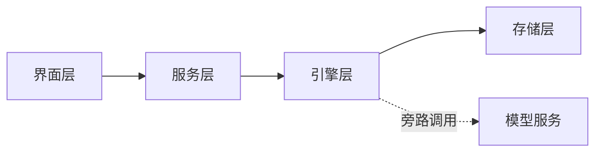

  
TOME AGENT / 卷宗

  
创新工程实践营 · 项目汇报 · 2026.11

  

    
A writing system for long-form fiction

    
Tome Agent.

    
让一个点子， 长成一部自洽的长篇。

    

      01 产品设计
      02 设计原则
      03 产品实现
    

  

  

    
卷

    

    
ONE IDEA · ONE NOVEL

  

  

    
<b>查军益</b>开发 · 生成框架

    
<b>秦宗鑫</b>创作与质量评估

    
<b>谭钧浩</b>环境与功能测试

    
<b>周涛</b>体验与成果文档

  

  
github.com/liuliyisui/tome-agent

<!-- 开场：Tome Agent 不是另一个聊天框，而是一套把长篇创作当成状态系统来管理的工具。 -->

---
layout: default
---

问题 / WHY

# 模型能写好一段， 却记不住一整部。

  

    
长篇不是一次生成，而是持续数周的创作过程：几十次模型调用、上百个设定、不断被推翻又重建的情节。

    

      

        
1

        
部完整作品

      

      

        
8–10

        
章连续叙事

      

      

        
N

        
次模型调用

      

    

    
每一次调用都可能改变人物状态、时间线或伏笔位置。真正的难点不是“下一句写什么”，而是“下一章还记不记得”。

  

  

    
“

    
真正的瓶颈不是文笔， 是<b>跨章状态</b>。

    
人物、物品、时间、伏笔、知识来源——只要有一个漂移，读者就会出戏。

    

    
Tome Agent 的答案：把长篇拆成可提交、可恢复、可追溯的状态变更。

  

来源：docs/requirements/problem_definition.md · docs/software/architecture.md

<!-- 先给判断：长篇的瓶颈是状态，不是单段文本质量。 -->

---
layout: default
---

问题 / 五个症状

# 读者不会说“状态漂移”， 只会说“看不下去了”。

  

    
01

    
人物漂移

    
上一章左撇子，下一章用右手开门。性格、口癖、关系随章节变化。

  

  

    
02

    
伏笔失踪

    
第 2 章埋下的信物，到第 8 章没有人再提起，读者比作者记得更清楚。

  

  

    
03

    
设定过期

    
角色已经知道真相，叙事却还当他不知道；时间线悄悄倒退。

  

  

    
04

    
中断即重来

    
一次超时、一次格式错误，几万字的进度回到起点，作者不敢再写。

  

  

    
05

    
成本黑箱

    
生成前不知道要花多少，生成后对不上账，越写越不敢调用。

  

  
同一个根因

  
记忆不是提示词问题，是状态管理问题。

  
上下文窗口会截断，摘要会失真，向量检索不能判断一条事实是否已经过期。

来源：docs/requirements/problem_definition.md · docs/requirements/user_stories.md

<!-- 五个症状对应五类用户痛点，最后收束到一个根因。 -->

---
layout: default
---

产品定义 / 使命与口号

# 先把「记得住」做对， 再谈「写得好」。

  

    
使命

    
把「创作一部长篇」的门槛， 从「会不会写」降到 <em>「说不说得清一个想法」</em>。

    
不是把作者变成机器，而是把系统该记的东西交还给系统。

  

  

    
主口号

    
一个点子， 一部自洽的长篇。

    
ONE IDEA. ONE COHERENT NOVEL.

    

    
对外一句话，界面、README、答辩开场都用同一句，不另起说法。

  

  

    
A

    
<b>门槛</b>给得出题材、主角和走向，就能拿到第 1 章。

  

  

    
B

    
<b>质量</b>每条设定都有版本、变更理由和正文出处，可逐条核验。

  

  

    
C

    
<b>归属</b>作品随时导出 Markdown，不被工具锁死。

  

来源：docs/requirements/problem_definition.md · README「产品优势」

<!-- 使命讲能做什么，口号讲凭什么选我们；三条判据分别对应门槛、质量、归属。 -->

---
layout: default
---

目标用户 / WHO

# 服务「想写却写不完」的人， 不是替代专业作家。

  

    
01核心用户

    
第一次写长篇的读者

    
<b>他们是谁</b>脑子里有一个世界，但没受过写作训练，也没写过十万字。

    
<b>卡在哪里</b>写到第三章人物就乱了，不知道该怎么继续，也不敢重读。

    
<b>我们要给</b>一条能走完的路：从想法到第 1 章，再到一个完整的故事。

  

  

    
02高价值用户

    
类型小说作者

    
<b>他们是谁</b>有稳定更新需求，设定复杂、伏笔多，最怕前后矛盾。

    
<b>卡在哪里</b>灵感不是问题，一致性才是；每次改设定都要重读全书。

    
<b>我们要给</b>可追溯的状态与来源，让修改只影响该影响的地方。

  

  

    
03延展用户

    
小型内容团队

    
<b>他们是谁</b>需要稳定交付、多人交接，不能把内容锁在一个工具里。

    
<b>卡在哪里</b>进度分散、成本不透明、人员一换就接不上。

    
<b>我们要给</b>任务、用量、导出和可恢复的工程化流程。

  

<b>不做什么：</b>不替代专业作家的审美判断，不承诺“一键神作”，也不把演示原型当作真实生成能力。

来源：docs/requirements/user_stories.md · docs/requirements/functional_spec.md

<!-- 三类用户，从个人到团队；边界同样重要。 -->

---
layout: default
---

价值主张 / VALUE

# 用用户故事说价值： 少重读，少试错，有退路。

  

    
01

    

      
作为第一次写长篇的读者

      
我希望只给出题材、主角和走向，就能先看到第 1 章，<b>以便判断这个故事值不值得写下去。</b>

    

    
先看到 故事成立

  

  

    
02

    

      
作为正在连载的作者

      
我希望每次改动都能查到设定出处和版本，<b>以便不用重读全书。</b>

    

    
改动 有据可查

  

  

    
03

    

      
作为需要交接的团队

      
我希望中断后能续写、完成后能导出 Markdown，<b>以便交付不被工具锁定。</b>

    

    
随时 能带走

  

  
价值不是“写得更多”，而是让作者<b>敢继续写下去</b>。

  
对应交付：创建作品 · 配置文风 · 费用确认 · 逐章生成 · 失败恢复 · 导出 Markdown

来源：docs/requirements/user_stories.md · README「核心功能」

<!-- 三条用户故事分别对应第一次写作、连载修改、团队交接。 -->

---
layout: default
---

差异化 / DIFFERENCE

# 不比谁更会写， 比谁记得住、谁不糊弄。

<table class="compare">
  <thead>
    <tr>
      <th>能力</th>
      <th>通用聊天</th>
      <th>写作插件</th>
      <th class="is-us">Tome Agent</th>
    </tr>
  </thead>
  <tbody>
    <tr><td>跨章记忆</td><td>靠上下文窗口，随时截断</td><td>局部设定，缺少全局状态</td><td class="is-us">结构化事件、人物与时间状态</td></tr>
    <tr><td>设定出处</td><td>没有稳定来源</td><td>有设定，但版本弱</td><td class="is-us">版本 + 变更理由 + 正文出处</td></tr>
    <tr><td>断点恢复</td><td>重开对话，从头再来</td><td>有限恢复</td><td class="is-us">阶段检查点，保留已完成正文</td></tr>
    <tr><td>成本可见</td><td>不透明</td><td>部分可见</td><td class="is-us">生成前预估，生成后用量记录</td></tr>
    <tr><td>数据归属</td><td>复制粘贴</td><td>留在平台内</td><td class="is-us">整本 Markdown，随时带走</td></tr>
  </tbody>
</table>

  

  
差异化的落点不是“更会写”，而是<b>更可管理</b>：状态有版本，失败可恢复，成本可解释，内容可迁移。

来源：docs/requirements/problem_definition.md · docs/algorithm/research.md

<!-- 与通用聊天和写作插件对比，优势集中在可管理性，而不是文采。 -->

---
layout: default
---

产品形态 / FORM

# 浏览器打开就能写， 一章一次事务提交。

  

    

      <i></i><i></i><i></i>
      tome.example.com
    

    

      <aside class="mock-side">
        
T

        
书架

        
第 3 章

        
文风

        
用量

      </aside>
      <main class="mock-main">
        
第 3 章草案

        
潮汐抵达之前

        

          

          

          

          

        

        
人物 12伏笔 7约 2,400 字

        
提交本章 →

      </main>
    

  

  

    

      01
      
<b>规划</b>拆章、定场景、确认本章目标

    

    

      02
      
<b>事件推演</b>先改状态，再写正文

    

    

      03
      
<b>正文生成</b>按事件写，不自由发挥

    

    

      04
      
<b>记忆归档</b>事实、版本、出处一起落盘

    

    

      05
      
<b>审核提交</b>一章一次事务，正文与状态同批写入

    

  

形态选择：云端 Web 服务。浏览器访问域名，登录账号即可写作；本地文件存储可降级运行，PostgreSQL 作为可选增强。

来源：README「核心功能」 · docs/requirements/functional_spec.md · code/frontend/

<!-- 先给用户看到的形态，再给后台的五段流程。 -->

---
layout: center
class: section
---

  
02

  

    
Design principles

    <h1>设计原则</h1>
    
四组，十二条。 每条原则都要落到一个动作、一份证据。

  

Tome Agent · 产品设计 / 设计原则 / 产品实现

<!-- 第二部分：十二条原则不是墙上的标语，而是能回到仓库里的决策。 -->

---
layout: default
---

原则总览 / 4 × 3

# 十二条原则， 一条主线：让作者敢一直用下去。

  

    
01方向

    
<b>需求定方向</b>先写清楚给谁、解决什么。

    
<b>信息校准方向</b>用真实状态修正判断。

    
<b>创新才有落脚点</b>创新放在状态与恢复。

  

  

    
02系统

    
<b>把作品当系统</b>人物、物品、时间分别建模。

    
<b>先发散后收敛</b>候选方案都评估，再选型。

    
<b>逐项优化</b>先一致性，再速度与文风。

  

  

    
03取舍

    
<b>能继承的不重造</b>只换编排层，保留领域逻辑。

    
<b>算清效益</b>不上不必要的框架。

    
<b>抢住时间窗口</b>先闭环，再增强。

  

  

    
04质量

    
<b>能测就测</b>单元、集成、数据库矩阵。

    
<b>能简就简</b>少一个运行时变量。

    
<b>每一步都审</b>规则、评审、CI 同源。

  

  
“

  
原则不是挂在墙上的词，而是<b>遇到取舍时，能解释为什么选这个、不选那个</b>。

结构对应：需求与信息 → 系统与迭代 → 继承与效益 → 测试与审查

<!-- 四组原则，从方向到系统，再到取舍和质量。 -->

---
layout: default
class: principle-page
---

  
01

  

    
原则组 I · 方向

    <h1>先问需求，再用信息校准</h1>
  

  

    
01

    

      
需求定方向

      
先把问题定义、功能规格、非功能约束和用户故事写成文档，再决定做什么、不做什么。

    

    
证据<code>docs/requirements/</code><em>problem_definition · functional_spec · user_stories</em>

  

  

    
02

    

      
信息校准方向

      
用真实仓库状态、测试记录和框架文档修正判断，不靠印象，也不把“框架能力”当成“产品能力”。

    

    
证据<code>docs/algorithm/architecture.md</code><em>能力边界与备选方案对比</em>

  

  

    
03

    

      
创新才有落脚点

      
把创新放在“事件先行 + 三层记忆 + 可恢复提交”，而不是为了新而新地换框架。

    

    
证据<code>docs/software/LANGGRAPH_MIGRATION.md</code><em>graph_runtime.py</em>

  

判断标准：这个决定，能不能在仓库里找到对应文件与测试？

先写清楚，再动手；先看证据，再下判断。

<!-- 第一组：方向。每条原则后面都跟证据，不空喊。 -->

---
layout: default
class: principle-page
---

  
02

  

    
原则组 II · 系统

    <h1>把作品当系统， 而不是一段文本。</h1>
  

  

    
04

    

      
把作品当系统设计

      
人物、物品、时间、事件分别建模；状态变化带版本，正文只是状态的一次投影。

    

    
证据<code>tome_writer/memory_system/</code><em>tiered_memory · events/continuity</em>

  

  

    
05

    

      
先发散后收敛

      
全量上下文、自然语言摘要、向量检索、事件状态四种方案都评估，再按一致性、成本和可恢复性收敛。

    

    
证据<code>docs/algorithm/architecture.md</code><em>备选策略对比表</em>

  

  

    
06

    

      
逐项优化

      
先保证跨章一致性，再补恢复能力，最后才谈速度与文风；一次只改一个变量，避免“越优化越乱”。

    

    
证据<code>docs/mgmt/ROADMAP.md</code><em>docs/retrospection/README.md</em>

  

系统视角：先定义状态，再定义操作；先保证正确，再追求好看。

状态先于文本，结构先于生成。

<!-- 第二组：系统。先建模，再比较方案，最后按顺序优化。 -->

---
layout: default
class: principle-page
---

  
03

  

    
原则组 III · 取舍

    <h1>用既有能力， 换确定性。</h1>
  

  

    
07

    

      
能继承的不重造

      
复用已接入的模型适配、事件推演与记忆函数；LangGraph 只替换编排层，控制迁移范围。

    

    
证据<code>memory_runtime/writing_flow/</code><em>graph_runtime.py · LANGGRAPH_MIGRATION.md</em>

  

  

    
08

    

      
算清效益

      
不引入 ASGI 框架、前端构建链和向量库；把省下的复杂度放在状态一致性与恢复上。

    

    
证据<code>README.md</code><em>「技术选型」与选型理由</em>

  

  

    
09

    

      
抢住时间窗口

      
先做出可演示、可验证的完整闭环：本地 Web + 文件存储；PostgreSQL 与 hosted 模式按需增强。

    

    
证据<code>docs/software/DEPLOY.md</code><em>WINDOWS_PORTABLE.md · LINUX_HOSTED.md</em>

  

取舍标准：新增的每一层，都要能回答“它替作者解决了什么”。

不是每个能力都值得自己造。

<!-- 第三组：取舍。把工程资源花在确定性上。 -->

---
layout: default
class: principle-page
---

  
04

  

    
原则组 IV · 质量

    <h1>把质量做成 默认动作。</h1>
  

  

    
10

    

      
能测就测

      
单元测试、集成测试、真实 PostgreSQL 17/18 矩阵、Linux hosted 回归；失败路径和成功路径一样要测。

    

    
证据<code>.github/workflows/tests.yml</code><em>tests/TEST_REPORT.md</em>

  

  

    
11

    

      
能简就简

      
标准库 HTTP 服务、Vue runtime-only、无 CDN、无前端构建步骤；少一个运行时变量，就少一类线上问题。

    

    
证据<code>code/frontend/</code><em>README「技术选型」</em>

  

  

    
12

    

      
每一步都审

      
Ruff 规则、pre-commit 与 CI 共用同一份配置；代码评审、质量报告与整改记录都留在仓库。

    

    
证据<code>docs/software/CODE_QUALITY_FIXES.md</code><em>code_review.md · .pre-commit-config.yaml</em>

  

质量不是最后一道门，而是每次提交都在走的默认路径。

质量不是一个里程碑，而是每次提交的默认值。

<!-- 第四组：质量。测试、简化、审查，三件事都变成默认动作。 -->

---
layout: default
---

取舍 / WHAT WE DON'T DO

# 我们刻意不做的事， 定义了产品是什么。

  

    
×

    
不做“一键神作”

    
不承诺无限长度，也不把演示原型当成真实生成能力。篇幅承诺只到验证过的 8–10 章。

    
改做 → 可验证的完整闭环

  

  

    
×

    
不做“全量上下文”

    
每次发送全书正文，成本随篇幅线性增长，还不保证模型真的用上所有历史。

    
改做 → 事件状态 + 按需记忆

  

  

    
×

    
不做“平台锁定”

    
作品不能只活在某个工具里。生成结果必须能整本导出，数据要能迁移。

    
改做 → Markdown 导出 + 开放存储

  

  

    
×

    
不做“看起来很重”的架构

    
不上 ASGI、前端构建链、向量库；这些复杂度没有直接改善跨章一致性。

    
改做 → 标准库 + 渐进式 Vue

  

取舍标准只有一个：<b>作者能不能一直用下去。</b>

来源：README「技术选型」 · docs/software/architecture.md · docs/software/DEPLOY.md

<!-- 不做什么，和做什么一样重要。四条取舍都指向长期可用。 -->

---
layout: center
class: section
---

  
03

  

    
Product implementation

    <h1>产品实现</h1>
    
从状态图到可运行的服务。 把设计原则变成代码、测试和部署记录。

  

Tome Agent · 产品设计 / 设计原则 / 产品实现

<!-- 第三部分：实现不是“写完了”，而是每个设计决定都能在仓库里找到落点。 -->

---
layout: default
---

3.1 架构 / ARCHITECTURE

# 四层边界：界面不碰模型，模型不碰存储。

  

    
01

    
<b>界面只表达意图</b>不拼提示词，不直接调模型。

  

  

    
02

    
<b>引擎只做编排</b>不依赖具体 HTTP 路由和页面。

  

  

    
03

    
<b>存储可替换</b>文件模式与 PostgreSQL 共享同一套领域语义。

  

请求路径 界面动作 → 服务层校验 → 引擎编排 → 检查点 / 数据库提交 → 结果回传。

架构不是分层越多越好，而是<b>每一层都能被替换、被测试、被解释</b>。

来源：docs/software/architecture.md · code/backend/inf_backend/service.py · code/core_engine/

<!-- 四层架构，重点是边界而不是分层数量。 -->

---
layout: default
---

3.5.3 编排 / LANGGRAPH

# 事件先行：先改状态，再写正文。

  

    
事件先行

    
不让正文猜事实

    
先规划场景事件并推演人物、物品和时间状态，再把状态写进正文。避免“正文写完才发现关键事实对不上”。

  

  

    
条件边

    
修订有上限

    
写作提出事件修订时，经条件边回到规划节点；保留一次修订上限，防止无限循环。

  

  

    
检查点

    
失败不丢正文

    
每个阶段保存原子检查点；恢复时识别待处理任务与损坏检查点，不把已经完成的章节推倒重来。

  

修订上限 让系统回到可收敛的路径；不是所有分歧都要靠“再生成一次”解决。

来源：docs/algorithm/LANGGRAPH.mmd · code/core_engine/memory_runtime/writing_flow/graph_runtime.py

<!-- 编排图：规划→写作→提交→记忆→审核，修订回到规划，最多一次。 -->

---
layout: default
---

3.5.3 记忆 / MEMORY

# 每条设定都带版本、 变更理由和正文出处。

  

    

      
工作记忆

      
当前章

      
本章计划、草稿、待提交变更；只服务这一次生成。

    

    

      
近期记忆

      
最近章节

      
近期事件、人物状态、未收线索；按需进入上下文。

    

    

      
长期记忆

      
全书事实

      
人物、物品、时间、知识来源；每条带版本、变更理由和正文出处。

    

  

  

    
01
<b>结构校验</b>
模型输出必须是合法 JSON；坏格式不写入状态。

    
02
<b>来源追踪</b>
设定变更记录来自哪一章、哪段正文，可回溯。

    
03
<b>失败降级</b>
局部规划或记忆失败时，保留已完成正文，标记待处理。

    
04
<b>审核门</b>
提交前检查连续性、人物状态与伏笔闭合情况。

  

<b>三层记忆不是向量库。</b>检索只能找到相似内容，不能判断一条事实是否已经过期；状态需要版本和来源。

来源：docs/software/architecture.md「事件先行与三层记忆」 · code/core_engine/memory_runtime/

<!-- 记忆分层，不等于把所有历史都塞进提示词。 -->

---
layout: default
---

3.5.4–3.5.5 数据与接口 / DATA

# 一章一次事务， 正文、状态、用量一起落盘。

  

    
PostgreSQL 数据模型

    

      
<code>tome_books</code>作品与元数据

      
<code>tome_chapters</code>章节与当前状态

      
<code>tome_chapter_versions</code>章节版本历史

      
<code>tome_jobs</code>生成任务与进度

      
<code>tome_usage</code>token 与费用记录

      
<code>tome_schema_version</code>迁移版本

    

    
PostgreSQL 可选；未配置时降级为文件模式。两种存储共享同一套领域语义。

  

  

    
真实 HTTP 路由

    

      
GET<code>/api/books</code><em>书架</em>

      
POST<code>/api/books/{id}/generate</code><em>生成</em>

      
POST<code>/api/books/{id}/chapters/{n}/edit</code><em>编辑</em>

      
POST<code>/api/books/{id}/chapters/{n}/review</code><em>复查</em>

      
GET<code>/api/jobs/{id}</code><em>任务状态</em>

      
GET<code>/api/books/{id}/export</code><em>导出</em>

    

    
后台任务通过 job id 查询；页面刷新不打断生成。

  

事务边界 章节内容 + 版本记录 + 用量，同批提交；任务状态单独记录，失败保留已完成部分。

来源：code/backend/inf_backend/schema.sql · code/backend/inf_backend/web.py

<!-- 数据模型与接口只列真实存在的表和路由，不画不存在的架构。 -->

---
layout: default
---

3.6 质量 / QUALITY

# 质量不是最后一道门， 是每次提交都在走的路。

  

256

测试通过

  

0

失败 / 跳过

  

61.01%

核心逻辑覆盖率

  

4

类 CI job

  

    
测试矩阵

    
<b>lint</b>Ruff check + Ruff format 全仓库校验

    
<b>test</b>Windows · unittest · 覆盖率脚本

    
<b>postgresql</b>PostgreSQL 17 / 18 矩阵 · 独立 schema

    
<b>hosted-linux</b>账号、hosted 服务与 worker 回归

  

  

    
把质量做成资产

    
<b>Ruff</b>75 处不合规 → 0；规则集中在 pyproject.toml

    
<b>pre-commit</b>格式化、YAML/TOML 校验与 CI 同源

    
<b>Code Review</b>问题、修复与复核记录留在仓库

    
<b>失败降级</b>保留已生成正文，区分请求失败 / 可能已计费 / 未审核

  

最近一次完整记录：tests/TEST_REPORT.md（2026-10-24）——256 项通过、0 失败、0 跳过；含真实模型端到端生成与真实 PostgreSQL 验证。

来源：tests/TEST_REPORT.md · .github/workflows/tests.yml · docs/software/CODE_QUALITY_FIXES.md

<!-- 质量数字来自仓库里的测试报告，不手填“感觉良好”。 -->

---
layout: default
---

小结 / SUMMARY

# 把复杂留给系统， 把简单留给作者。

  

    
01

    
产品

    
一个点子， 一部自洽的长篇。

    
目标用户、价值主张、差异化与产品形态

  

  

    
02

    
原则

    
四组十二条， 每条都有证据。

    
从需求、系统、取舍到质量

  

  

    
03

    
实现

    
状态图 + 三层记忆 + 一章一事务。

    
四层架构、真实路由、可恢复提交

  

  
<b>185</b>次提交

  
<b>5</b>个模块

  
<b>6</b>张数据表

  
<b>4</b>类 CI job

  
REPOgithub.com/liuliyisui/tome-agent

  
SLIDESliuliyisui.github.io/tome-agent/

来源：README.md · docs/software/architecture.md · tests/TEST_REPORT.md · git log

<!-- 收束：产品、原则、实现三句话；最后给出仓库和幻灯片地址。 -->

---
layout: center
class: end
---

  
Tome Agent · 2026.11

  
先把「记得住」做对， 再谈「写得好」。

  

  
谢谢观看 · 欢迎提问

  
宇宙无敌暴龙战士 · 查军益 / 秦宗鑫 / 谭钧浩 / 周涛

<!-- 结束页：留白，不堆信息。 -->
