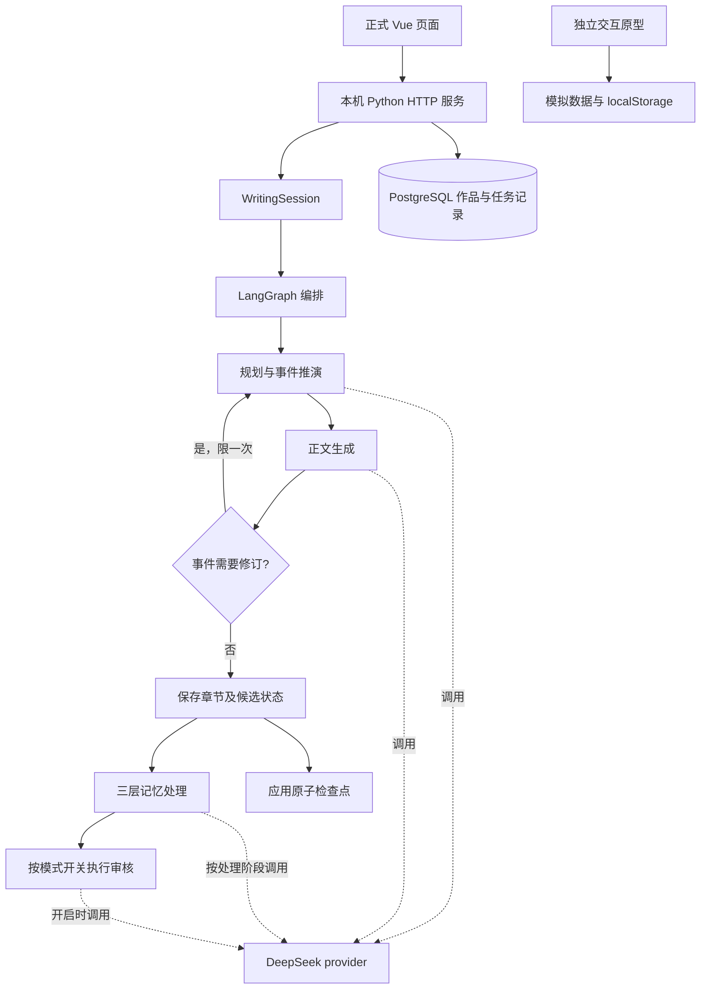

# Tome Agent 技术方案调研报告

| 项目 | 内容 |
| --- | --- |
| 文档版本 | v1.2 |
| 调研日期 | 2026-10-24 |
| 项目目标 | 面向中文长篇创作，提供故事规划、逐章生成、跨章记忆、恢复与导出能力 |
| 代码基线 | `develop` 已提交 LangGraph 更新 `a3db76b`，并以合并提交 `931be5c` 整合远端 `main` 的 `fded20d` |
| 学习周期 | 2026-10-25—2026-10-31，共 7 天 |
| 报告范围 | 核心技术选型、实际架构与边界、新技术学习任务、自学计划和验收里程碑 |
| 证据原则 | 区分代码已实现、离线测试已验证、历史记录与未来计划；不把框架能力等同于产品能力 |

## 一、需求与选型标准

Tome Agent 的主要技术难点是：长篇生成需要多次模型调用，人物、物品和时间状态必须跨章保留；输出格式、网络或审核服务可能失败；已保存正文不能因后续步骤失败而丢失。课程还要求采用现有技术框架，并能说明成员分工、实现过程和验证依据。

本阶段以本机单用户工作室为范围，不以公网多租户服务为设计目标。选型按以下标准判断：

| 标准 | 对本项目的具体要求 |
| --- | --- |
| 流程可控 | 能显式表达规划、写作、记忆、审核，以及修订和恢复分支 |
| 数据可信 | 正文、结构化事实、计划和历史信息分开处理，状态变化有证据和版本 |
| 故障可恢复 | 保存已完成章节及阶段，能够识别待处理任务和损坏检查点 |
| 集成成本 | 复用既有 Python 引擎和 DeepSeek 接口，避免一周内重写全部业务 |
| 可学习与可展示 | 各成员能讲清自己的模块，并用代码、测试和演示说明结果 |
| 成本可见 | 记录 token 和用量，调用前确认；费用估计不冒充账单或强制扣费上限 |

本报告围绕已确定的 LangGraph 技术路线，依据当前仓库、既有测试记录及官方文档，说明采用理由、模块职责与实施计划。

## 二、核心技术选型论证

### 2.1 多智能体编排：LangGraph

**结论：采用 LangGraph 1.2.17 负责流程编排，保留项目已有的模型适配、事件推演、记忆与校验模块。** LangGraph 用状态、节点和边组织流程，允许确定性函数与模型步骤组合，适合本项目需要控制执行顺序和返回修订的工作流。[官方概览](https://docs.langchain.com/oss/python/langgraph/overview)

项目已确定使用 LangGraph，采用理由如下：

| 项目需要 | LangGraph 的应用方式 | 对项目的作用 |
| --- | --- | --- |
| 多角色分工明确 | 将规划、写作、记忆处理和审核定义为独立节点 | 可以检查每个角色的输入、输出及执行顺序 |
| 支持事件修订 | 用条件边将写作节点返回规划节点 | 先修订事件方案，再继续生成正文，保留修订次数限制 |
| 复用已有业务代码 | 在节点中调用现有模型适配、事件推演和记忆函数 | 保留已验证的领域逻辑，控制迁移范围 |
| 执行路径便于展示 | 通过显式状态图与调用记录说明正常和异常路径 | 便于团队学习、故障定位及课程答辩 |
| 恢复职责清楚 | 图负责调度，应用检查点负责当前版本的状态保存 | 沿用现有完整性校验，并明确后续持久化学习范围 |

当前真实入口是 [`WritingSession`](../../code/core_engine/memory_runtime/writing.py)，由 [`graph_runtime.py`](../../code/core_engine/memory_runtime/graph_runtime.py) 构建并编译 `StateGraph`。规划、写作、提交、记忆和审核为独立节点；写作提出事件修订时，经条件边返回规划节点，保留一次修订上限。基础严格事务入口 [`Coordinator`](../../code/core_engine/inf_writer/runtime.py) 也使用 LangGraph，通过审核条件边选择提交或拒绝。

**能力边界：** 当前继续用应用自身的原子检查点恢复作品，未启用 LangGraph 原生 checkpointer、任意节点级重放或人工 `interrupt()`。官方 checkpointer 与长期 store 的职责不同，未来接入前应先确认和现有作品状态的关系，避免两套状态互相覆盖。[LangGraph 持久化文档](https://docs.langchain.com/oss/python/langgraph/persistence)

### 2.2 开发语言与服务层：Python 3.11

选用 Python 3.11 作为验证基线，复用已有引擎、标准库测试与 HTTP 适配代码。当前本地服务使用 `ThreadingHTTPServer`，无需再引入一层 Web 框架即可提供同源界面与接口；生成任务通过后台线程执行，页面查询任务状态。

与立即迁移 FastAPI 或 Django 相比，保留现有服务层可减少同期变更，优先完成 LangGraph、存档和前后端联调。代价是接口验证、错误转换和线程管理仍由项目维护。若后续转为公网服务或多用户系统，应重新评估 ASGI 框架、认证和任务队列；本报告不把当前服务称为已具备生产部署能力。Python 官方也指出 `http.server` 不建议用于生产环境。[官方说明](https://docs.python.org/3.11/library/http.server.html)

代码依据：[`web.py`](../../code/backend/inf_backend/web.py)、[`service.py`](../../code/backend/inf_backend/service.py)、[`pyproject.toml`](../../code/backend/pyproject.toml)。当前依赖已经包含 LangGraph 和 Psycopg，不再是“仅依赖 Python 标准库”。

### 2.3 模型服务：DeepSeek Chat Completions

继续采用已经接入的 DeepSeek 官方接口，通过项目自己的 provider 封装请求、响应、超时和用量记录。DeepSeek 提供兼容的 API 格式，因此可以保持模型调用与 LangGraph 调度分离，不需要为了换编排框架同时更换模型服务。[DeepSeek 接口文档](https://api-docs.deepseek.com/)

相较于此时更换服务商，沿用现有接口能复用配置、计费预估和故障测试；相较于本地部署模型，不需要本周额外承担模型下载、显存和推理服务维护。该选择不表示已经证明 DeepSeek 的小说质量最好或价格最低。模型名、官方价格及可用性可能变化，应以实际配置和调用当日官方信息为准，不在本报告写死价格。

主要风险是网络失败、响应截断、格式不符与事实判断错误。应记录实际用量和错误，保留已完成正文，并区分“请求失败”“可能已计费”和“内容未审核”。迁移本身不会解决人物复活或情节重复。

代码依据：[`chat_provider.py`](../../code/core_engine/inf_writer/chat_provider.py)、[`official_pricing.py`](../../code/backend/inf_backend/official_pricing.py)。

### 2.4 长篇一致性：事件先行与三层记忆

采用“规划事件 → 推演候选状态 → 生成正文 → 保存 → 处理记忆”的策略。工作、近期和长期记忆保留不同范围的信息，并携带正文来源；人物、物品、时间和知识状态由领域规则校验，不把全部历史聊天直接重复发送。

| 备选策略 | 优点 | 当前不单独采用的原因 |
| --- | --- | --- |
| 每次发送全书正文 | 信息直接 | 随篇幅增长会增加上下文和调用成本，且不保证模型正确使用所有历史 |
| 仅保存自然语言摘要 | 实现较简单 | 摘要可能省略状态变化，难以精确追溯旧值、版本和证据 |
| 仅用向量检索 | 便于语义查找 | 相似度不能独自判断事实是否过期，也不能替代状态更新和事务校验 |
| 事件状态与三层记忆 | 明确状态变化，按需选择上下文，能够追溯来源 | 选用；代价是结构契约、预算管理和失败修复更复杂，需要专项测试 |

这些取舍来自项目设计分析，不是已经完成的检索方案性能实验。向量检索可作为后续补充，但本周不新增向量数据库，以免扩大交付范围。

代码依据：[`event_first.py`](../../code/core_engine/memory_runtime/event_first.py)、[`engine.py`](../../code/core_engine/memory_runtime/engine.py)、[`tiered_memory.py`](../../code/core_engine/inf_writer/tiered_memory.py)。事件先行模式目前沿用“正文故事审核关闭”的配置；不能因为图中存在审核节点就宣称每章正文都经过模型审核。

### 2.5 持久化：PostgreSQL、Psycopg 与应用检查点

选用 PostgreSQL 管理作品、章节版本、文风、任务和用量；Python 通过 `psycopg[binary]==3.3.3` 访问。仓库 Compose 默认 PostgreSQL 17，CI 配置覆盖 17 与 18。数据库事务适合保证一次操作中的多个修改一起成功或回滚；Psycopg 的提交和回滚行为需由团队明确理解。[PostgreSQL 事务](https://www.postgresql.org/docs/18/tutorial-transactions.html)、[Psycopg 事务管理](https://www.psycopg.org/psycopg3/docs/basic/transactions.html)

相较于仅用 JSON 文件管理书架，关系数据库更适合跨作品查询、章节版本和任务状态；SQLite 对单机产品也可行，但切换会增加当前已有 SQL、锁和迁移代码的重写。本周继续 PostgreSQL，并接受需要安装数据库或容器的运维成本。

必须区分两类保存：数据库保存应用查询所需记录及当前检查点信息；引擎仍在本地保存完整的阶段检查点，用于事件、记忆和源码指纹校验。两者不是一个跨数据库与文件系统的原子事务，需通过“文件保存成功而数据库更新失败”的故障演练确认恢复行为，不能宣称该边界已自动解决。

代码依据：[`schema.sql`](../../code/backend/inf_backend/schema.sql)、[`database.py`](../../code/backend/inf_backend/database.py)、[`writing.py`](../../code/core_engine/memory_runtime/writing.py)。

### 2.6 界面：渐进式 Vue 3 与本地资源

使用已有 HTML、CSS、JavaScript 页面，逐步由 Vue 3.5.44 管理书架和废案箱等响应式组件。采用本地 runtime-only 运行时与 `h()` 渲染函数，减少对 CDN 和前端构建环境的依赖。Vue 支持独立脚本等渐进接入方式，渲染函数也是正式支持的接口。[Vue 使用方式](https://vuejs.org/guide/extras/ways-of-using-vue.html)、[渲染函数](https://vuejs.org/guide/extras/render-function.html)

相较于立即重建 React/Vue 单页工程，渐进方案复用现有功能并缩小本周学习范围；代价是现有命令式交互与组件状态共存，必须明确接口、事件和重复提交控制。

正式界面位于 [`code/frontend`](../../code/frontend/README.md)，独立展示原型位于 [`prototype`](prototype/README.md)。原型以模拟数据和 localStorage 展示交互，不调用模型、不读写正式存档；原型演示不能作为真实生成或数据库持久化的证据。

### 2.7 环境与协作：Compose、GitHub Actions

用已有 Compose 文件描述本地 PostgreSQL 服务、健康检查和数据卷，方便成员复现同一数据库环境；也允许按项目说明使用本机数据库。Compose 的价值在于把环境依赖明确写进配置，不代表已完成云部署。[Docker Compose 文档](https://docs.docker.com/compose/intro/features-uses/)

用 GitHub Actions 执行 Python 测试及 PostgreSQL 版本矩阵，保留本机和 CI 两类结果。采用 `unittest` 与离线模型夹具验证流程，真实模型质量另做人工评估，不让普通回归测试产生调用费用。[GitHub Python CI 指南](https://docs.github.com/en/actions/tutorials/build-and-test-code/python)

远端已同步 Windows 打包脚本，但迁移后 EXE 尚未重新构建和验证。本周将其作为条件允许时的扩展任务，优先保证源码安装和真实服务演示。

## 三、总体架构与验证边界

2026-10-24 整合远端更新后重新验证：应用回归 112 项，其中 105 项通过、7 项因未配置 PostgreSQL 跳过；长篇入口回归 42 项，其中 39 项通过、3 项因历史资产缺失跳过。包括重规划、审核拒绝、记忆失败保留正文和中断恢复，两组命令均正常结束。这些结果只说明相应测试场景成立，不等于真实模型质量认证；未重新运行真实 PostgreSQL 集成或真实模型生成。

本周仍需重点验证：真实数据库恢复；数据库与检查点文件之间的失败边界；文风保存后只影响下一章；长期事实变更是否进入写作上下文。旧版检查点因源码或依赖指纹不同不能直接续写，不能通过手改哈希绕过限制。

## 四、未来一周需要学习的新技术

下列安排依据仓库现有[团队分工](../mgmt/COMMUNICATION_AND_RISK_PLAN.md)提出，不代表已经完成个人能力测评。成员姓名和职责沿用项目资料；以下学习与验收均为计划，执行时在 Issue 中记录进展。

| 技术或知识点 | 必须掌握的内容 | 主要学习人 / 交叉复核 | 练习与可检查产物 | 优先级 |
| --- | --- | --- | --- | --- |
| LangGraph | StateGraph、共享状态、节点、条件边、compile/invoke；框架恢复与应用恢复区别 | 查军益 / 谭钧浩 | 解释现有图；运行一次重规划与一次审核拒绝，提交调用路径记录 | P0 |
| 事件状态与记忆契约 | 当前事实、历史证据、计划、候选状态；阶段保存与失败队列 | 查军益、秦宗鑫 / 谭钧浩 | 构造“人物状态变化后续章仍引用旧值”的案例，记录输入上下文与审核结果 | P0 |
| DeepSeek API 与用量 | messages、JSON 输出校验、超时、截断、token、预估与实际用量差别 | 查军益、秦宗鑫 / 周涛 | 用离线 provider 复现超时和坏 JSON，确认错误可见且已保存正文保留 | P0 |
| PostgreSQL 与 Psycopg | 基础查询、JSONB、事务、回滚、行锁与作品锁、章节版本 | 谭钧浩 / 查军益 | 在一次性测试库完成建表、保存、重复提交和失败回滚，保留测试日志 | P0 |
| Vue 3 渐进接入 | reactive、createApp、h、组件事件与异步请求状态 | 周涛 / 秦宗鑫 | 演示文风保存、删除恢复、费用确认取消与提交，核对正式界面及原型差别 | P0 |
| Docker Compose | 环境变量、启动与停止、健康检查、数据卷和备份 | 谭钧浩 / 周涛 | 新建独立测试环境，重启数据库后记录仍可查询；不操作真实作品库 | P1 |
| Git 与 CI | fetch/merge、冲突解决、PR 评审、Actions 测试结果与 skipped 的区别 | 全员，谭钧浩整理 / 查军益复核 | 每人完成一次有交付物的提交或评审；说明一次失败检查及修复 | P0 |
| PyInstaller 打包边界 | 依赖收集、运行时元数据、可写数据目录和配置隔离 | 周涛、谭钧浩 / 查军益 | 有余量时做新版 EXE 启动验证；未通过则交付源码启动方案 | P2 |

## 五、自学计划（2026-10-25—10-31）

每天建议投入约 90 分钟：阅读官方资料 20 分钟、在一次性环境动手 50 分钟、记录与复盘 20 分钟。全员周投入约 10.5 小时/人；10 月 28 日和 31 日各安排一次约 20 分钟的交叉检查。此为学习时间估算，不是已承诺工时。

| 日期 | 学习重点 | 成员任务 | 当日产物与验收方式 |
| --- | --- | --- | --- |
| 10-25（D1） | 环境和架构入门 | 查军益梳理 LangGraph 入口；谭钧浩安装独立依赖并启动测试数据库；周涛运行正式页面及独立原型；秦宗鑫整理创作验收场景 | 各人提交环境记录；标明 Python、依赖、数据库及运行命令，至少能区分正式服务与模拟原型 |
| 10-26（D2） | 状态图与修订分支 | 查军益演示 planner/writer 回边；谭钧浩复现审核拒绝；周涛对照页面请求；秦宗鑫说明正文、事实和计划的区别 | 完成 M1；两名成员能独立解释图路径，提供测试输出和一次状态变化示例 |
| 10-27（D3） | 模型接口和状态契约 | 查军益阅读 provider 与错误处理；秦宗鑫编写人物、物品、时间三类连续性案例；谭钧浩注入超时/坏 JSON；周涛核对用户可见错误 | 三类案例表及两种故障日志，错误不得被误标为内容审核通过 |
| 10-28（D4） | 数据库事务与恢复 | 谭钧浩运行真实 PostgreSQL 测试；查军益说明锁与文件/数据库边界；周涛验证重启后可读；秦宗鑫复核重复操作 | 完成 M2；保留测试库日志，验证重复提交、回滚和重启；未测场景明确列为未验证 |
| 10-29（D5） | Vue 与端到端交互 | 周涛演示组件状态、文风保存和任务进度；查军益核对接口；谭钧浩做取消/重复点击测试；秦宗鑫检查创作操作顺序 | 五个核心场景的步骤、结果和截图；模拟生成与真实调用明确区分 |
| 10-30（D6） | 集成与独立复现 | 四人交叉运行非本人负责的模块；查军益和谭钧浩检查 CI；周涛整理演示材料；秦宗鑫复核连续性案例 | 完成 M3；另一名成员独立完成源码安装及核心场景，记录阻塞问题和降级方案 |
| 10-31（D7） | 验收与知识分享 | 每人讲解自己模块及一个失败场景；全员完成约 8 分钟演示；周涛整理报告，秦宗鑫核对需求证据，查军益与谭钧浩复核版本 | 完成 M4；形成演示记录、测试摘要、已知问题和下一周计划，更新文档与任务状态 |

优先阅读第二节各技术对应的官方资料，再对照代码运行小练习。无需通读全部框架源码；学习结果必须能落实到代码位置、运行记录或可复现操作，不能只提交“已看教程”。

## 六、Milestone 与交付验收

| 里程碑 | 截止时间 | 牵头 / 复核 | 交付物 | 通过条件 |
| --- | --- | --- | --- | --- |
| M0 基线就绪 | 10-24 | 查军益 / 谭钧浩 | 已提交的 LangGraph 更新与整合远端后的代码基线 | 本地包含 `fded20d` 的变更，LangGraph 图入口保留，工作可追溯到提交 |
| M1 编排可解释 | 10-26 | 查军益 / 谭钧浩 | 图路径说明、修订和拒绝分支运行记录 | 两名成员分别说明共享状态、节点与边；重规划不重复提交正文，严格审核拒绝不提交候选状态 |
| M2 数据可恢复 | 10-28 | 谭钧浩 / 查军益 | 一次性 PostgreSQL 环境、事务和恢复日志 | 创建与读取成功；重复提交不重复增加章节；失败事务回滚；重启后读取已保存记录；列明文件/数据库边界未覆盖项 |
| M3 核心交互贯通 | 10-30 | 周涛 / 秦宗鑫 | 五场景验收单与安装复现记录 | 创建作品、文风保存、费用确认取消、逐章保存与恢复、Markdown 导出均有结果；另一成员独立复现 |
| M4 一周学习验收 | 10-31 | 秦宗鑫 / 全员交叉复核 | 测试摘要、贡献记录、演示材料与后续问题表 | 每人能解释一个模块和一个故障；证据链接完整；无阻断源码演示的未处理缺陷，未测能力不写成已完成 |

不把“测试命令返回成功”直接等同于全部场景通过。报告应分别列出通过、失败和跳过数量；数据库未启动导致的跳过不能满足 M2。真实模型评估若需进行，先由团队确认费用和测试规模，再使用新建测试作品，记录模型、时间、用量和人工评价；普通学习及 CI 使用离线夹具。
