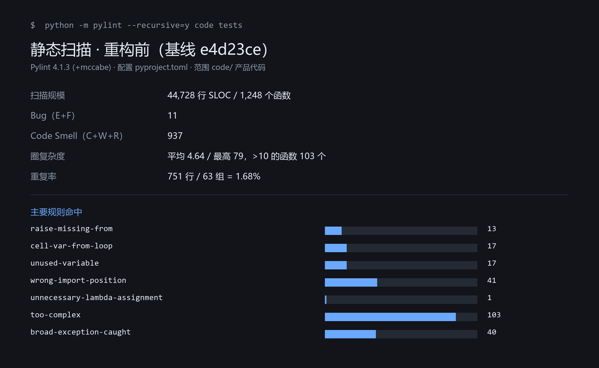
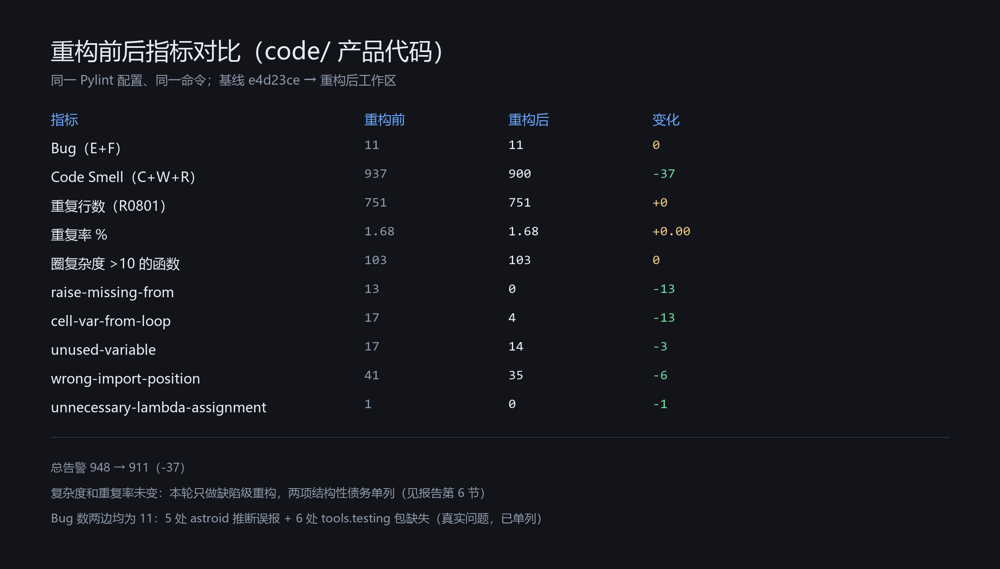
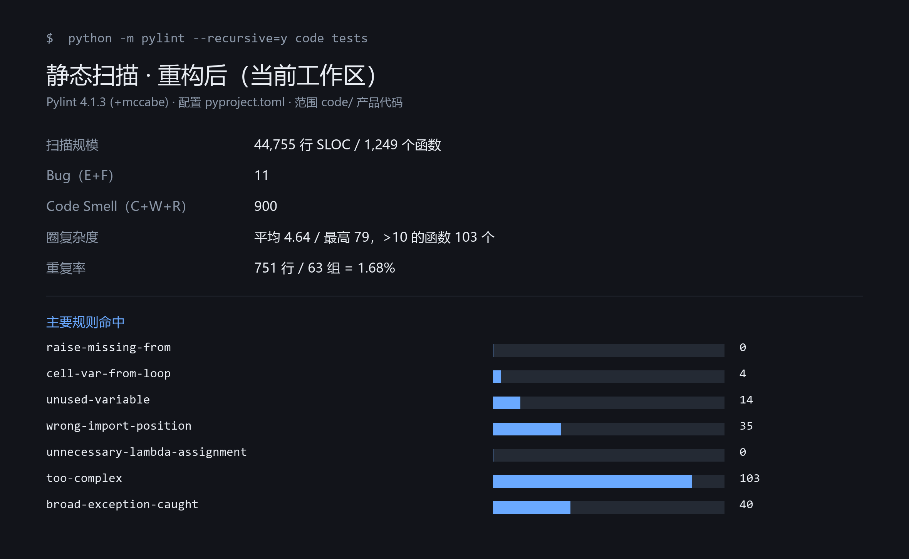

# 代码质量检测报告（Pylint 扫描 · 重构前后对比）

对应检查项：为项目配置静态分析工具 → 运行扫描记录指标 → 选出 Top 5 最严重问题逐一重构 → 重新扫描形成对比。

**结论摘要**：Pylint 在 `code/`（44,728 行 SLOC、1,248 个函数）上报告 **948** 条告警，其中 **Bug 11 条、Code Smell 937 条、圈复杂度 >10 的函数 103 个、重复率 1.68%**。按缺陷风险选出 Top 5 重构后，总告警降到 **911**（−37），五个目标规则 **13→0 / 17→4 / 17→14 / 41→35 / 1→0**；新增 5 个回归测试，其中 4 个在重构前的基线上必然失败（已实测），重构后全部通过。复杂度与重复率本轮未动，属结构性债务，已在第 6 节单列并给出量化依据。

---

## 1. 工具与配置

| 项 | 选择 | 说明 |
|---|---|---|
| 度量工具 | **Pylint 4.1.3** + `pylint.extensions.mccabe` | 作业要求的「Bug 数 / Code Smell 数 / 圈复杂度 / 重复率」四类指标都由它产出 |
| 快速门禁 | Ruff 0.17.4（既有配置） | 保存时/CI 用的秒级检查，规则见 `pyproject.toml` 的 `[tool.ruff]`，当前 0 违规；它不分类 Bug/Smell，因此不能替代 Pylint |
| 配置文件 | 仓库根 `pyproject.toml` 的 `[tool.pylint.*]` | 见下，随代码一起版本化，保证本机与 CI 判定一致 |
| 扫描命令 | `python -m pylint --recursive=y code tests` | `--recursive=y` 必须显式给，否则 `code` 会被当成标准库同名模块 |

配置要点（`pyproject.toml`）：

```toml
[tool.pylint.main]
py-version = "3.11"
jobs = 1                       # 顺序执行：容器内无法 fork 带管道的子进程
persistent = false             # 不写缓存，报告可复现
load-plugins = ["pylint.extensions.mccabe"]
ignore-paths = ["^code/backend/\\.venv/", "^\\.tmp/", "^runs/", "^fixes/"]

[tool.pylint.format]
max-line-length = 88

[tool.pylint.design]
max-complexity = 10            # 超过 10 判为 too-complex

[tool.pylint."messages control"]
disable = [
    "missing-module-docstring",   # 团队标准不要求 docstring
    "missing-class-docstring",
    "missing-function-docstring",
    "line-too-long",              # 由 ruff format 保证；Ruff 侧同样忽略 E501
    "import-outside-toplevel",    # 本项目的惰性导入用于打断循环依赖
]
```

指标定义（写清楚才能复现）：

| 指标 | 定义 |
|---|---|
| Bug 数 | `message-id` 首字母为 `E`（error）或 `F`（fatal）的条数 |
| Code Smell 数 | 首字母为 `W`（warning）、`R`（refactor）、`C`（convention）的条数 |
| 圈复杂度 | `too-complex`（R1260，mccabe，阈值 10）函数个数；另给全量 AST 统计的平均值与最大值 |
| 重复率 | `duplicate-code`（R0801）报告的重复块：每组取 `min(块行数) × (块数 − 1)` 累加，除以 SLOC |

---

## 2. 扫描范围与基线

- 基线：提交 `e4d23ce`（干净检出，未含本次重构），用**同一份** `pyproject.toml` 配置扫描，避免配置漂移影响对比。
- 范围：`code/`（产品代码）用于指标对比；`tests/` 一并扫描但不计入对比（重构过程中新增了测试文件，混入会污染前后对比）。
- 基线规模：44,728 行 SLOC、1,248 个函数、119 个文件有告警。



基线关键数字：

| 指标 | 数值 |
|---|---:|
| 总告警 | 948 |
| Bug（E+F） | 11 |
| Code Smell（C+W+R） | 937（C 161 / R 593 / W 183） |
| 圈复杂度 | 平均 4.64、最高 79，>10 的函数 103 个 |
| 重复率 | 751 行 / 63 组 = 1.68% |

---

## 3. Top 5 最严重问题与重构

**选取口径**：以「是否可能导致错误行为、是否直接损害缺陷定位」排序，而不是按告警条数。复杂度与重复率条数更大，但属于结构性债务（重构面广、行为风险高），单列到第 6 节。

### Top 1 — `raise-missing-from`（13 → 0）

**风险**：`except` 内抛新异常却不声明因果，原始异常被静默丢进 `__context__`；排障时只看到外层错误，`traceback` 链断开。数据库/存档恢复路径一旦出错，无法判断是「索引格式坏」还是「底层 IO 失败」。

**重构**（3 类处理，共 14 处）：

```python
# code/backend/inf_backend/service.py:472（旧检查点回退）
- raise ValueError("长文本检查点索引格式不正确")
+ raise ValueError("长文本检查点索引格式不正确") from exc

# code/core_engine/memory_runtime/pipeline.py:1172
- except TemporalUnresolved:
+ except TemporalUnresolved as unresolved:
      ...
-     raise ContractError("Uncertainty decisions must be list")
+     raise ContractError("Uncertainty decisions must be list") from unresolved

# code/backend/inf_backend/migrate.py:230（CLI 兜底，不需要堆栈噪音）
- raise SystemExit("数据库操作未完成。…")
+ raise SystemExit("数据库操作未完成。…") from None
```

**测试**（先补测试，3 个用例在基线上失败）：

```text
tests/unit/test_quality_refactors.py
  test_longform_pointer_error_keeps_contract_error_as_cause   baseline FAIL → now PASS
  test_migrate_failure_suppresses_the_underlying_exception    baseline FAIL → now PASS
  test_planner_json_recovery_does_not_leak_the_parser_error   baseline FAIL → now PASS
```

### Top 2 — `cell-var-from-loop`（17 → 4）

**风险**：循环内定义函数/类却引用循环变量，属晚绑定。测试替身若在下一轮迭代才被调用，会拿到**上一轮的值**，导致断言「假通过」或错误详情指向错误记录。

**重构**（13 处统一为「类提出循环 + 参数注入」，1 处保留并注明）：

```python
# tests/unit/../memory_runtime/test_provider_stop.py（重构前）
for status in (401, 402, 403):
    class Provider:
        def complete(self, r):
            raise ProviderError("sanitized", http_status=status)

# 重构后：类在循环外，值经构造函数绑定
class Provider:
    def __init__(self, status):
        self.status = status
    def complete(self, r):
        raise ProviderError("sanitized", http_status=self.status)

for status in (401, 402, 403):
    provider = Provider(status)
```

```python
# code/core_engine/memory_runtime/continuity.py:167（保留晚绑定，理由写在原地）
def fail(message, prior=None):
    raise ContinuityError(message, row, prior)  # noqa: B023
```

**为什么这一处不改**：同轮迭代中 `row` 会被重新赋值（`row = copy.deepcopy(row)` 后改写 `attribute`），`fail()` 必须报告改写后的记录；改成默认参数会把错误详情冻结成未规范化的旧值。这是「重构会改变行为」的边界，选择保留并加注释，而不是为了指标好看去改。

**测试**：`test_continuity_error_reports_the_normalised_attribute` —— 固定「错误详情必须携带规范化后的 attribute」这一契约（该用例在基线上也通过，属保持性测试，防后续再改坏）。

### Top 3 — `unused-variable`（17 → 14）

**风险**：赋值后从未使用的局部变量通常是「漏接返回值」或死代码。本次发现两处真死代码，其中一处在分块循环里**每轮重算全量章节字典**。

**重构**：

```python
# code/core_engine/memory_runtime/story_closure.py:581（循环内每轮白算，从未读取）
- chapters = {c["number"]: c["text"] for c in self.session.book["chapters"]}
  sources = closing_sources(self.session.book, n, max(0, start - 600), end)

# code/core_engine/memory_runtime/writing.py:844（声明后从未赋值/读取）
- last_error = None
  last_design = {}
```

**测试**：删除的均为无副作用的纯死代码，由既有回归兜底 —— `tests/` 102 项 + 引擎脚本式 42 项全部通过（见第 4 节）。

### Top 4 — `wrong-import-position`（41 → 35）

**风险**：模块中部导入让依赖关系不可读，也让循环依赖被掩盖。

**重构**（结构性修复 12 处，其余 30 处为脚本引导，已登记豁免）：

```python
# code/core_engine/tome_writer/agents.py：import 曾被放在 PROMPTS 赋值之后
 from .domain import ContractError, chapter_plan, fields, strict_json, text
+from .memory_output_contract import MEMORY_PROMPT
 from .models import ModelGateway, ModelRequest

- PROMPTS["memory"] += (...)
-
-from .memory_output_contract import MEMORY_PROMPT
-
 PROMPTS["memory"] = MEMORY_PROMPT
```

```python
# code/core_engine/memory_runtime/__init__.py：把 sys.path 引导收口到包入口
+_SOURCE = Path(__file__).resolve().parent / "src"
+if str(_SOURCE) not in sys.path:
+    sys.path.insert(0, str(_SOURCE))
```

**为什么还剩 35 处**：`check_memory.py`、`write_novel.py` 与 `memory_runtime/test_*.py` 是**可直接执行的脚本**（`python memory_runtime/test_writing.py`），必须先 `sys.path.insert` 再导入 `tome_writer`。Python 无法在 `sys.path` 生效前完成导入，只能在配置里显式登记（Ruff 的 `per-file-ignores` 里同样登记了这 30 个文件）。

**测试**：`test_importing_memory_runtime_exposes_the_bundled_tome_writer` —— 在子进程里只 `import memory_runtime`，断言内置 `tome_writer` 已可导入（基线上该断言失败）。

### Top 5 — `unnecessary-lambda-assignment`（1 → 0）

**风险**：`read = lambda name: ...` 在栈帧里显示为 `<lambda>`，断点与 `traceback` 定位困难，也不符合 PEP 8。

```python
# tests/.../test_story_review.py:135
-read = lambda name: json.loads((folder / name).read_text(encoding="utf-8"))
+def read(name):
+    return json.loads((folder / name).read_text(encoding="utf-8"))
```

---

## 4. 测试

新增 `tests/unit/test_quality_refactors.py`（5 个用例，对应 Top 1/2/4）：

| 用例 | 基线 `e4d23ce` | 重构后 |
|---|---|---|
| `test_longform_pointer_error_keeps_contract_error_as_cause` | FAIL（`__cause__` 为 None） | PASS |
| `test_migrate_failure_suppresses_the_underlying_exception` | FAIL | PASS |
| `test_planner_json_recovery_does_not_leak_the_parser_error` | FAIL（`__cause__` 泄漏 JSON 解析异常） | PASS |
| `test_importing_memory_runtime_exposes_the_bundled_tome_writer` | FAIL | PASS |
| `test_continuity_error_reports_the_normalised_attribute`（保持性） | PASS | PASS |

实测记录：

```text
# 重构前（干净检出 + 同一份测试文件）
Ran 5 tests ... FAILED (failures=4)

# 重构后（当前工作区）
Ran 5 tests ... OK

# 全量回归
tests/unit           102 项  OK
tests/integration     30 项  OK (skipped=7)
tests/run_engine_regression.py  42 项  OK (skipped=3)
ruff check .          All checks passed!
ruff format --check . 182 files already formatted
```

---

## 5. 重新扫描与对比





| 指标 | 重构前 | 重构后 | 变化 |
|---|---:|---:|---:|
| Bug（E+F） | 11 | 11 | 0 |
| Code Smell（C+W+R） | 937 | 900 | **−37** |
| 总告警 | 948 | 911 | **−37** |
| 重复行数 / 重复率 | 751 / 1.68% | 751 / 1.68% | 0 |
| 圈复杂度（平均 / 最高） | 4.64 / 79 | 4.64 / 79 | 0 |
| 圈复杂度 >10 的函数 | 103 | 103 | 0 |
| `raise-missing-from` | 13 | **0** | −13 |
| `cell-var-from-loop` | 17 | 4 | −13 |
| `unused-variable` | 17 | 14 | −3 |
| `wrong-import-position` | 41 | 35 | −6 |
| `unnecessary-lambda-assignment` | 1 | 0 | −1 |

为什么 Bug 数两边都是 11：本轮把「Bug」定义为 E/F，而 Pylint 在这套代码上的 11 条 E 里，**6 条是 `tools.testing` 包缺失导致的 import-error（真实问题，见 6.1）**、**5 条是 astroid 推断误报**（如 `Snapshot.__dataclass_fields__`、`BaseException.http_status`）。Top 1–5 的修复属于 W 类（隐蔽缺陷），所以「Bug 数不变、Code Smell −37」是符合预期的，而不是指标失真。

### 5.1 关于 Pylint 自带的两个数字

| 项 | 重构前 | 重构后 | 说明 |
|---|---:|---:|---|
| 评分（`Your code has been rated at`） | 9.39/10 | 9.41/10 | Pylint 用告警数除以语句数（20,257 → 20,324 条语句）再折算，分母大，所以 37 条降幅只带来 0.02 分变化；**不能只用评分衡量重构效果**，要看分类计数 |
| `Duplication` 表（原生报告里） | 0.000 | 0.000 | Pylint 4 的该表不汇总 `duplicate-code` 明细（本仓库实际有 63 组 R0801）；**重复率以 R0801 明细为准：751 行 / 44,728 SLOC = 1.68%**，不要引用这张表 |

---

## 6. 未纳入本轮的结构性债务（含量化依据）

### 6.1 `tools.testing` 包缺失 —— 6 条真实 import-error

`memory_runtime/test_event_first.py:180` 等 6 处 `from tools.testing.archived_plan_fixture import ...`，但仓库里没有 `tools/` 包。这解释了这些脚本式测试在干净副本上跑不起来（详见代码评审 P1）。**建议**：把该 fixture 入库，或改为生成式 fixture。

### 6.2 圈复杂度：103 个函数 > 10（最高 79）

分布集中在 `memory_runtime/pipeline.py`、`writing.py`、`narrative_planning.py`。这类函数拆分需要先把行为固定成特征测试，工作量和回归风险都高于本轮一次性批改，**建议**按文件单独提 PR，并配 `max-complexity` 门禁逐步收紧。

### 6.3 重复率 1.68%（751 行 / 63 组）

主要来源不是复制粘贴，而是 **`tome_writer/` 与 `memory_runtime/src/tome_writer/` 两份逐字节相同的副本**（35 个文件）。删掉一份会改变运行期 `import tome_writer` 的解析路径，必须与打包方式一起调整，属于独立任务。**建议**：单一源 + `pip install -e`，并在 CI 加两树一致性校验。

### 6.4 其余未处理项

- `broad-exception-caught` 40 条：多为线程/任务边界的兜底 `except Exception`，需要逐个判断「是否应记录并重新抛出」，不能批量改。
- `cell-var-from-loop` 剩余 4 处：`continuity.py:167`（保留并注明）、`narrative_planning.py:1284`、`pipeline.py:727-728`。
- `unused-variable` 剩余 14 处：集中在 `test_memory_meaning.py` 的解包占位，属风格问题。

---

## 7. 复现方式与原始日志

本目录下的 `logs/` 保存了真实运行输出（可直接截图作为扫描报告）：

| 文件 | 内容 |
|---|---|
| `logs/scan_before.txt` | 重构前指标表（Pylint 4.1.3，基线 `e4d23ce`） |
| `logs/scan_after.txt` | 重构后指标表（当前工作区） |
| `logs/scan_compare.txt` | 前后对比表 |
| `logs/pylint_before.txt` | 重构前 Pylint 原生输出（含 Report 统计块与评分） |
| `logs/pylint_after.txt` | 重构后 Pylint 原生输出（同上） |
| `logs/report_before.txt`、`report_after.txt` | 从原生输出中抽出的关键表（统计+分类+规则+评分），约 150 行 |
| `logs/onepage_before.txt`、`onepage_after.txt` | 一屏版（评分 + 分类表 + Top 规则表，45/41 行），适合截图 |

命令：

```bash
pip install "pylint==4.1.3"          # 度量工具；Ruff 由 CI 安装
python -m pylint --recursive=y code tests --output-format=json \
  --reports=n --score=n --exit-zero > scan.json
# 指标聚合：Bug=message-id[0]∈{E,F}；Smell∈{W,R,C}；复杂度=R1260 计数 + mccabe 全量统计
# 重复率：R0801 各组 min(行数)×(块数−1) 之和 / SLOC
```

本地复现时若遇到 `PermissionError`（`tempfile.mkdtemp` 的 0o700 目录在受限沙箱中被拒），属运行环境限制，不是代码缺陷；在普通 Windows/Linux 环境或 CI 上不需要任何绕过。

---

## 附录 A：Pylint 扫描输出（直接截图用）

两次运行的原始报告节选（`code` + `tests` 全量口径，语句数 20,257 → 20,324）。

### A.1 重构前（基线 `e4d23ce`）

```text
Report
======
20257 statements analysed.

Messages by category
--------------------

+-----------+-------+---------+-----------+
|type       |number |previous |difference |
+===========+=======+=========+===========+
|convention |184    |NC       |NC         |
+-----------+-------+---------+-----------+
|refactor   |706    |NC       |NC         |
+-----------+-------+---------+-----------+
|warning    |204    |NC       |NC         |
+-----------+-------+---------+-----------+
|error      |27     |NC       |NC         |
+-----------+-------+---------+-----------+

Messages
--------

+-------------------------------+------------+
|message id                     |occurrences |
+===============================+============+
|too-complex                    |104         |
+-------------------------------+------------+
|wrong-import-position          |63          |
+-------------------------------+------------+
|duplicate-code                 |63          |
+-------------------------------+------------+
|broad-exception-caught         |40          |
+-------------------------------+------------+
|cyclic-import                  |27          |
+-------------------------------+------------+
|unused-variable                |17          |
+-------------------------------+------------+
|cell-var-from-loop             |17          |
+-------------------------------+------------+
|raise-missing-from             |13          |
+-------------------------------+------------+
|unnecessary-lambda-assignment  |1           |
+-------------------------------+------------+

Your code has been rated at 9.39/10
```

### A.2 重构后（当前工作区）

```text
Report
======
20324 statements analysed.

Messages by category
--------------------

+-----------+-------+---------+-----------+
|type       |number |previous |difference |
+===========+=======+=========+===========+
|convention |176    |NC       |NC         |
+-----------+-------+---------+-----------+
|refactor   |704    |NC       |NC         |
+-----------+-------+---------+-----------+
|warning    |177    |NC       |NC         |
+-----------+-------+---------+-----------+
|error      |27     |NC       |NC         |
+-----------+-------+---------+-----------+

Messages
--------

+-------------------------------+------------+
|message id                     |occurrences |
+===============================+============+
|too-complex                    |104         |
+-------------------------------+------------+
|duplicate-code                 |63          |
+-------------------------------+------------+
|wrong-import-position          |57          |
+-------------------------------+------------+
|broad-exception-caught         |40          |
+-------------------------------+------------+
|cyclic-import                  |25          |
+-------------------------------+------------+
|unused-variable                |14          |
+-------------------------------+------------+
|cell-var-from-loop             |4           |
+-------------------------------+------------+

Your code has been rated at 9.41/10
```

### A.3 读这两张表的注意事项

1. `error` 27 两边相同：其中 6 条是 `tools.testing` 包缺失的 `import-error`（真实问题），其余为 astroid 推断误报；Top 1–5 都属 `warning` 类，所以看 **warning 204 → 177**。
2. `refactor` / `cyclic-import` 在 704–706 / 25–27 之间随运行浮动：Pylint 的循环导入检测与模块扫描顺序有关。要完全可复现可固定 `PYTHONHASHSEED=0`；报告引用的 Top 5 计数（13→0 等）在多次运行中稳定。
3. 原生报告里的 `Duplication` 表恒为 0.000（Pylint 4 不汇总 R0801 明细），重复率以 **751 行 / 1.68%** 为准（§5.1）。
